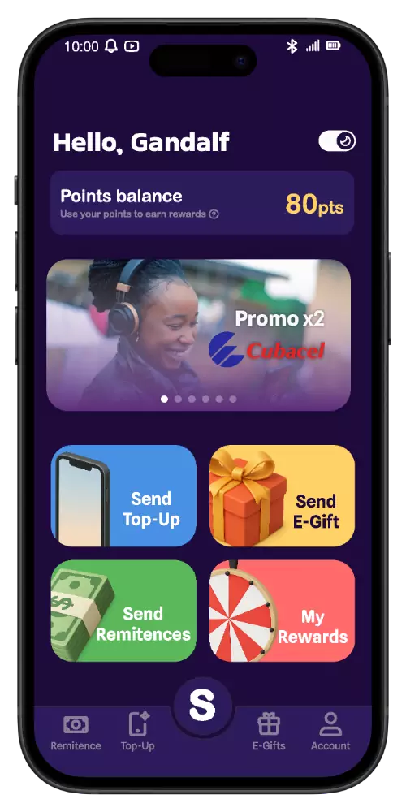




<strong>Open App → Spin the Wheel → Top Up</strong>


<strong>Open App → Top Up → Payment confirmed → Spin the Wheel</strong>









<h2>The brand and the screens</h2>








<h3>There were few purchases</h3>

Spin App let users spin a wheel for a reward <em>before</em> paying for a top-up. I knew there were few purchases.

<h3>I didn't have the data</h3>

I didn't know it from data: it was just intuition. (I know, in UX there's no intuition, there's user feedback.) The back-end developer was the one with access to those numbers.

<h3>The wheel comes after paying</h3>

Flipping the flow was my idea: the wheel, after paying.

I based it on conventions already established in similar apps, which were part of my research, to see if we could attract customers from the competition and keep the learning curve gentle.

<h4>Before: Spin, then pay</h4>

<strong>Open App → Spin the Wheel → Top Up</strong>

<ul>
  <li>The user spins <em>before</em> buying.</li>
  <li>A skull for a loss could put them off buying. This was my hypothesis, without data.</li>
</ul>
<h4>After: Pay, then spin</h4>

<strong>Open App → Top Up → Payment confirmed → Spin the Wheel</strong>

<ul>
  <li>The user spins <em>after</em> a confirmed purchase.</li>
  <li>Every spin wins something: cashback, points, or double recharge.</li>
</ul>

<h3>The brand and the screens</h3>
<h4>Brand Evolution</h4>

The original brand used clashing neon colors. I made a calmer palette that still feels playful, and a logo that suggests movement.



<h4>UI Evolution</h4>

I replaced the cluttered list view with cards. "Top Up" is the most visible action. The country code is filled in from the contact's number, which removes one step from every transaction.



<h3>The test: 3 people</h3>

I tested it with 3 people. One is a developer with deep knowledge of ergonomics, accessibility and UX, who gave me the green light. The other two, also developers, went through the flow in the Figma prototype.

<h3>What I would have measured</h3>

The purchases made, how many users came back and how often, and how long they spent on each screen (if possible).

In UX there's no intuition: there's user feedback.

<h3>Project Gallery</h3>

The final screens and a promo video made for the redesign.

<figure class="case-fig">
  <video controls muted playsinline preload="none" poster="/assets/img/spin_view.webp" width="1920" height="1080">
    <source src="/assets/img/Spin_app/spin_video.mp4" type="video/mp4">
  </video>
</figure>


<figure class="case-fig c-narrow"><figcaption>Mockup in context</figcaption></figure>



